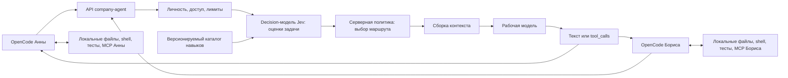

# OpenCode → агент как модель: многопользовательская концепция

Дата: 6 ноября 2026. Статус: проектное предложение; сервер пока не реализован.

Подтверждённый сценарий: сотрудники пишут код в своих OpenCode, подключаются
к единому API как к модели; сервер разбирает запросы, маршрутизирует их и подгружает
нужные навыки. Пользователь уточнил: на серверной стороне работает отдельная
decision-модель типа Jev; далее это роль диспетчера. Jev от TypeSafe рассматривается
как конкретный кандидат, версия и способ поставки ещё не выбраны.
Общая удалённая архитектурная память не следует автоматически
из требования многопользовательской работы и не является условием первого этапа.

## 1. Основное решение

Создать серверного провайдера модели с внутренним выбором навыков. Сотрудник
выбирает в OpenCode одну виртуальную модель, например `company-agent`.
OpenCode сохраняет локальный агентский цикл: историю, чтение файлов, правки,
команды, тесты, MCP и запросы разрешений. Сервер управляет вызовами LLM,
каталогом навыков, маршрутизацией, персональной авторизацией, лимитами и аудитом.



Каждый ответ возвращается только инициировавшему запрос сотруднику. Общая
виртуальная модель не означает общую историю или общий рабочий каталог.
Сервер не получает доступ к диску сотрудника от одного подключения `base_url`.
Код и результаты локальных инструментов поступают ему в сообщениях OpenCode.

Это один серверный продукт с несколькими обязанностями, а не обязательный набор
микросервисов. В целевом варианте decision-модель и рабочая LLM разделены:
первая оценивает задачу для маршрутизации, вторая генерирует код, ответы и вызовы
инструментов. Для MVP достаточно одной рабочей LLM; выбор между несколькими
рабочими моделями добавляется после измерения качества, задержки и стоимости.

## 2. Кто за что отвечает

| OpenCode сотрудника | Сервер агента |
|---|---|
| Пользовательский диалог и локальная сессия | Персональная авторизация и область запроса |
| Актуальная история и результаты локальных инструментов | Анализ задачи и выбор разрешённого навыка |
| Список доступных tools и локальные permissions | Подключение версии навыка и выбор профиля LLM |
| Исполнение read/edit/shell/test и локальных MCP tools | Возврат текста и корректных tool calls |
| Compaction, локальные помощники, подтверждения действий | Совместимость API, квоты, журнал маршрутизации |
| Рабочая копия, Git-ветка и локальные секреты | Ключи провайдеров LLM и управляемый каталог навыков |

Первый вариант не исполняет на сервере присланные OpenCode инструменты и не
создаёт второй цикл локального редактирования. При необходимости серверных
интеграций позже появится отдельный набор инструментов с отличимыми именами,
полномочиями и исполнителем. Их нельзя незаметно смешать с локальными tools.

Сервер может ограничивать доступ к своим моделям и данным. Его prompt или фильтр
ответа не контролируют произвольные команды на машине сотрудника. Permissions
OpenCode и политика архитектурного графа также не объявляются OS sandbox.

## 3. Сквозной сценарий

Пример: «Добавь API-метод и тесты по принятой архитектуре».

1. OpenCode отправляет историю, инструкции текущего агента, схемы доступных tools,
   выбранную виртуальную модель и параметры генерации. Сотрудник авторизован
   персональным токеном сервера.
2. Сервер устанавливает личность и область запроса, проверяет лимиты и ограничения
   передачи кода провайдерам. Краткий каталог доступных навыков передаётся диспетчеру.
3. Decision-модель определяет тип задачи, предметную область и потребность
   в тестировании. Серверная политика по этим оценкам выбирает, например,
   `python.backend` и `testing`, архитектурный контекст и профиль рабочей модели.
4. Сервер проверяет маршрут, закрепляет версии навыков и дополняет контекст
   инструкциями выбранного пакета. Инструкции локального агента и режим работы
   OpenCode сохраняются; навык не должен превращать режим планирования в запись кода.
5. Рабочая модель возвращает вызов доступного инструмента чтения файла.
   Сервер передаёт `tool_calls` в OpenCode, сохраняя идентификаторы и структуру.
6. OpenCode проверяет локальные permissions, исполняет инструмент и присылает
   результат следующим запросом, связанным с исходным вызовом.
7. Сервер продолжает задачу с теми же версиями навыков и совместимым профилем модели.
   Далее OpenCode аналогично выполняет запрошенную правку и запуск тестов.
8. Рабочая модель формирует ответ о фактических изменениях, результатах тестов
   и оставшихся проблемах. Сервер фиксирует технический результат запроса и расход.

Один пользовательский ход может потребовать нескольких запросов к API модели.
Сервер не должен считать каждый результат инструмента новой независимой задачей.
Неуспешные тесты или отсутствие нужного MCP-инструмента остаются явными данными;
подключение навыка не создаёт отсутствующий инструмент.

## 4. Контракт провайдера

Первый кандидат — OpenAI-совместимый Chat Completions с полноценными инструментами
и streaming, доступный как собственный provider в OpenCode. Предлагаемые endpoints:
`POST /v1/chat/completions` и `GET /v1/models`; виртуальный ID — `company-agent`.
Это новый проектируемый API, которого сейчас в architect-harness нет.

Текущая официальная документация OpenCode описывает custom provider,
`options.baseURL` и адаптер `@ai-sdk/openai-compatible` для Chat Completions;
для Responses используется другой вариант. См. [OpenCode Providers](https://docs.opencode.ai/docs/providers/#custom-provider).
Конкретный конфиг нужно проверить для используемой версии: текущий проект
ориентирован на OpenCode 2.2.5. Общая страница документации не заменяет проверку
контракта этой версии. В концепции не устанавливаются ни provider, ни ключи.

Статическое чтение установленного `~/.opencode/bin/opencode` версии 2.2.5
показало нативную секцию `providers` и поля `package`, `settings`, `headers`,
`body`, `models`. Встроенный `@opencode/ai/providers/openai-compatible` использует
`/chat/completions` и разбирает потоковые `delta.tool_calls`. В бинарнике есть и
старые структуры `npm/options`; пример из общей документации поэтому нельзя
выдать за проверенный нативный конфиг. Это свидетельство наличия реализации,
не успешный вызов нового provider по сети.

В профиле совместимости необходимо явно зафиксировать:

- Порядок и роли сообщений, инструкции локального агента, `tools`, `tool_choice`,
  `tool_calls` и связь ответов через `tool_call_id`.
- Потоковые фрагменты текста и аргументов tools, индексы нескольких вызовов,
  ID, завершение ответа, ошибки, отмену и учёт usage.
- Поддерживаемые параметры генерации, ограничения контекста, мультимодальность
  и особенности reasoning выбранного провайдера. Неизвестные возможности нельзя
  молча игнорировать или рекламировать в описании виртуальной модели.
- Преобразование между клиентским протоколом и фактическим провайдером.
  Переключение модели не должно разрывать историю вызовов или требуемые opaque-данные
  продолжения. Если совместимость не доказана, модель закрепляется на задачу.

Формат сообщений и потоковых tool calls описан в официальной документации OpenAI:
[Chat Completions](https://developers.openai.com/api/reference/resources/chat/subresources/completions/methods/create),
[streaming events](https://developers.openai.com/api/reference/resources/chat/subresources/completions/streaming-events).
Простого возврата строки assistant недостаточно для рабочего кодингового цикла.
Полная поддержка обоих API или всех провайдеров пока не обещается.

Лимит контекста виртуальной модели должен быть консервативным для допустимых
маршрутов и учитывать место для серверных инструкций. Если выбранная модель
не вмещает историю, сервер не удаляет молча обязательные инструкции или связанные
пары tool call/result: требуется совместимая модель либо явная обработка
переполнения с участием OpenCode. Клиент и сервер не запускают независимо две
несогласованные политики сжатия одного диалога.

## 5. Decision-модель Jev и навыки

Пользователь указал [jevmodel.org](https://jevmodel.org/). Сайт описывает Jev
от TypeSafe и обозначает себя независимым ресурсом; технические свойства ниже
сверены с [официальной документацией TypeSafe](https://docs.typesafe.ai/introduction).
Jev принимает состояние и типизированные вопросы, возвращая оценки/варианты,
которые обрабатывает код приложения. Для него уместны отдельные короткие вопросы
вместо генерации свободного плана. Приведённая ниже схема маршрута — наш
нормализованный результат серверной политики, а не буквальный API-ответ Jev.

Предлагаемые оценки: тип задачи из заданного списка (`explain`, `implement`,
`debug`, `test`, `review`), предметная область, сложность по рубрике и факт смены
цели. Код сервера объединяет оценки с доступными tools, каталогом навыков,
политикой обработки данных и бюджетом. Разрешения, существование инструмента,
проверку квоты и выбор версии пакета вычисляет сервер. Пороги уверенности и
поведение при неопределённости проверяются на запросах сотрудников.

Компонент маршрутизации располагается на серверной стороне. Возможность размещения
самих весов Jev в нашей инфраструктуре пока не подтверждена; вызов hosted API
и локальный inference — разные варианты поставки. Если обязательно локальное
исполнение модели, это критерий выбора Jev либо аналога, который нужно проверить
до реализации. Успешных вызовов Jev в рамках этой концепции не выполнялось.

На вход диспетчеру поступают текущая задача, достаточный контекст для её понимания,
описания разрешённых навыков и доступные возможности клиента. Полный каталог
инструкций и все приватные данные сотрудников ему не нужны.

Предлагаемый внутренний результат маршрутизации:

```json
{
  "request_kind": "interactive",
  "primary_skill": "python.backend",
  "supporting_skills": ["testing"],
  "model_profile": "coding",
  "needs_clarification": false
}
```

Это внутренний формат после обработки оценок, а не новые поля API OpenCode. Версии пакетов
разрешает и закрепляет сервер. Личность, права, секреты и разрешение на действие
не определяются JSON-ответом модели.

Маршрут выбирается при новой задаче и пересматривается при существенном изменении
цели. Ответ инструмента обычно продолжает прежний маршрут. Для новой задачи
в той же сессии допустим другой навык. Неоднозначность может приводить к уточнению
или общему навыку программирования; ошибка диспетчера не даёт дополнительных прав.
Простой служебный запрос не обязательно оплачивает полный цикл маршрутизации.

Нужно отличать основной диалог, задания помощников, генерацию заголовка и compaction.
Служебные запросы должны соблюдать исходный формат результата и получать только
уместные инструкции. В надёжном варианте тип запроса передаётся адаптером явно;
эвристика по тексту — ограниченное резервное поведение, а не доказанный контракт.
Поле `request_kind` нормализует технические метаданные хоста: оценка Jev не может
переопределить явно переданный тип `compaction`, `title` или `helper`. Эти клиентские
метки не дают дополнительных полномочий и не отменяют общие лимиты.

Каталог навыков содержит ID, версию, хеш, назначение и исключения, инструкции,
требования к tools, профиль модели, конфликты сочетаний и критерии результата.
На одну задачу выбирается основной навык и небольшой совместимый набор дополнений.
Например, `code.explain`, `python.backend`, `frontend`, `testing`, `code.review`,
`architecture.design`. Это предложения каталога, не уже готовые реализации.

Навык на сервере в первом варианте — инструкции, справочные материалы и правила
работы с доступными tools. Он не устанавливает автоматически исполняемый скрипт
или MCP-server на компьютер сотрудника. Для таких компонентов требуется отдельная
управляемая поставка на клиент с явными версиями и локальными permissions.

Новые версии навыков публикуются владельцем каталога. Активная задача сохраняет
закреплённую версию; новый запрос не должен случайно получить другую процедуру
посреди работы. Отзыв небезопасной версии может остановить её использование.
Файлы репозитория и результаты tools — данные, а не канал изменения серверной
политики, разрешённых моделей или области доступа сотрудника.

## 6. Многопользовательская изоляция

Для исходного сценария многопользовательская работа означает независимые coding
сессии сотрудников на общей серверной мощности. Совместная работа с кодом
проходит через привычные репозитории, ветки и PR. Общий API модели сам по себе
не обеспечивает совместное редактирование рабочей копии или согласование Git-конфликтов.

Нужно различать следующие области:

| Идентификатор/объект | Назначение |
|---|---|
| `organization_id`, `principal_id` | Доверенная область организации и личность сотрудника |
| `project_id` | Проверенная принадлежность проекту, если нужны проектные политики |
| `client_session_id` | Локальная сессия OpenCode; непривилегированная метка, не право доступа |
| `task_id` | Текущая цель внутри сессии и закреплённый маршрут |
| `request_id`, `parent_request_id` | Отдельная генерация, повтор и продолжение после tools |
| `route_binding` | Версии навыков, профиль модели, версия политики и контекстная область |

Каждому сотруднику выдаётся собственный отзываемый токен. Личность берётся из
проверки токена, а не из имени в prompt, поля `user` или непроверенного заголовка.
Ключи внешних LLM принадлежат серверу и не выдаются клиентам. Персональные credentials
локальных tools остаются у OpenCode и не должны попадать в отправляемые сообщения.

Ключ серверного состояния включает организацию, сотрудника и сессию, а при наличии
проектной политики — также проверенный проект. Одинаковый session ID у двух сотрудников
не объединяет их маршруты. Дочерние агенты получают собственные привязки; основной
агент не делит с ними изменяемый «текущий навык». Одновременные запросы одной
задачи фиксируют выбранный маршрут атомарно, а не перезаписывают глобальную переменную.

Проверки доступа нужны на всех путях: чтение состояния, метрики сотрудника,
повторный ответ, артефакт, кеш и журнал. Приватные ответы не кешируются только по
тексту prompt. Общий кеш допустим для заведомо общих пакетов навыков; кеш кода
и результатов учитывает область доступа, версии и правила хранения.

Исходный код и логи проходят через сервер и выбранного LLM-провайдера. До внедрения
нужно определить допустимые места обработки, срок хранения и доступ операторов.
Для первого варианта серверу достаточно метаданных маршрута и расхода; сохранение
полных исходников и transcripts не должно включаться неявно. Аудит не хранит
секреты или скрытые рассуждения; клиентские сообщения об исполнении помечаются
как клиентские сведения, не как самостоятельно захваченные сервером свидетельства.

## 7. Привязка маршрута: два варианта

| Вариант | Возможность | Ограничение |
|---|---|---|
| Только provider, без plugin | Сотрудник меняет подключение; сервер маршрутизирует переданный контекст без скрытой общей памяти | Нельзя предполагать наличие надёжного task/session ID, типа служебного запроса и подтверждения исполнения tools |
| Provider и небольшой plugin OpenCode | Явные идентификаторы сессии/задачи, тип вызова, стабильная версия навыка, корреляция продолжений | Зависимость от проверенного plugin/provider API конкретной версии OpenCode |

В установленном OpenCode 2.2.5 статически найдены `x-opencode-session-id`
(текущий ID), `x-opencode-parent-session-id` и `x-opencode-project`. При этом
`x-opencode-session`, `x-session-affinity` и `X-Session-Id` могут использовать
ID родителя или исходной fork-сессии: они подходят для affinity, но не для
уникального разделения диалогов. Даже точный session ID учитывается только внутри
области аутентифицированного сотрудника; локальный project ID не выдаёт прав.

Также найдены hooks `model.request`, `http.request`, `http.response`; первый
содержит изменяемые `baseURL/headers`. Их прохождение через выбранный provider
и достаточность для типа запроса/границы задачи ещё не проверены по сети.
Приоритет — использовать штатные метаданные. Plugin добавляется только для
подтверждённых пробелов; он связывает локальный цикл с сервером и не переносит
маршрутизацию на клиент. Доказательства статического чтения сохранены в
[отчёте](../reports/opencode-provider-static-audit.json); это не сетевой тест.

Первый эксперимент можно сделать как stateless provider: каждый запрос обрабатывается
по присланной истории, без глобального checkpoint и без обещания устойчивой
серверной сессии. Это проверяет кодинговый цикл, но не доказывает постоянство
маршрута после compaction или обновления каталога. Если гарантии требуют состояния,
а API версии не передаёт метаданные, понадобится поддерживаемое расширение provider
или plugin; нельзя заменять их угадыванием личности и сессии по тексту.

## 8. Параллельность и отказоустойчивость

Разные пользователи и сессии обрабатываются параллельно с лимитами по сотруднику,
проекту и организации. Счётчики квот и закрепление маршрута согласованы между
работниками сервера. Одна долгая задача не должна занимать все слоты; учитываются
вызовы диспетчера, рабочей модели и допустимых повторов. Численные лимиты определяются
измерениями на рабочих сценариях, а не произвольным обещанием числа сотрудников.

В `usage` ответа OpenCode отражается вызов рабочей модели, включая добавленные
сервером инструкции. Расход Jev учитывается отдельно: прибавлять его к контексту
рабочей модели нельзя, иначе нарушаются оценка заполнения окна и compaction.
Суммарная стоимость всех вызовов доступна в серверном учёте.

До начала выдачи ответа возможен ограниченный повтор генерации или разрешённый
fallback. После передачи части потока нельзя незаметно продолжить его другой
генерацией: это может смешать текст и аргументы tools. Ошибка завершает конкретный
поток, а клиент решает, как восстановить шаг. Сервер не выдаёт повторённые частичные
аргументы за новый законченный вызов.

Повтор API-запроса и повтор локального действия — разные события. Ключ идемпотентности
может предотвращать повторную серверную генерацию для того же входа, но сервер
провайдера не способен гарантировать exactly-once локальную запись или shell-команду.
Сохранение ID tool calls необходимо, однако защита от повторного исполнения
должна быть проверена в клиентском цикле. Разрыв сети и отмена генерации не
откатывают уже исполненную локальную команду.

Для первого развёртывания достаточно модульного серверного приложения и небольшого
хранилища учётных записей/маршрутов/квот, если эти функции не предоставляет существующее
окружение. SQLite допустим как ограниченное допущение односерверного пилота.
Для нескольких реплик требуется согласованное общее состояние; выбор серверной БД
обосновывается доступностью и измеренной нагрузкой. Отдельные брокер, векторная БД,
распределённый планировщик и удалённые рабочие копии исходным сценарием не требуются.

## 9. Связь с существующим architect-harness

Подтверждено чтением проекта:

- [OpenCode-адаптер](../src/architect_harness/opencode.py) и
  [plugin](../src/architect_harness/assets/opencode-plugin.js) уже загружают
  архитектурный контекст для настроенных ролей. Это локальная интеграция,
  а не сервер provider с динамическим выбором навыков.
- [Доменное ядро](../src/architect_harness/core.py) обеспечивает граф, ревизии,
  неизменяемое предложение, рассмотрение и безопасный повтор его применения.
  Эти правила остаются у доменного модуля и не переносятся в router.
- [MCP](../src/architect_harness/mcp_server.py) работает через stdio и может
  оставаться локальным инструментом OpenCode. Выбранный сервером архитектурный
  навык использует его только при наличии соответствующих tools в запросе клиента.
- Текущий профиль `architect` ограничивает инструменты своей ролью. Подключение
  нового provider само по себе не превращает его в универсального исполнителя
  правок кода. Для coding-сценария требуется подходящая роль OpenCode и её permissions.
- [Операционная память](../src/architect_harness/memory.py) сейчас имеет общий
  checkpoint на файл проекта, а архивный `session_id` не является ACL. Эту память
  нельзя превращать в общий серверный store сотрудников без нового разделения владения.

Поэтому серверный provider — новый хостовый слой. Существующий harness остаётся
одной из доступных возможностей, преимущественно для архитектурного навыка.
Начальный coding-пилот может работать с локальным harness каждого сотрудника
или без него. Пользовательская история и постоянная память остаются на клиенте;
сервер хранит только явно выбранные служебные данные.

Если позже потребуется единый архитектурный граф команды, это отдельное расширение:
доступ на проект, личные checkpoint, авторизованный review и согласование ревизий.
Общий граф не делает общий checkpoint безопасным. В текущем ядре два предложения
к одной ревизии конфликтуют после первого commit, а добавление наблюдения тоже
меняет ревизию. Новое согласование должно относиться к новому неизменяемому diff.
Локальная строка reviewer и `mcp-agent` не устанавливают удалённую личность.

Схема графа v0.1 и существующие установки в рамках концепции не меняются.
Будущее состояние provider получает отдельную версию схемы. При последующем
переносе локальных архивов нельзя выдумывать владельца из первого подключившегося
сотрудника: legacy-данные требуют явного рассмотрения области публикации.
Никакая миграция сейчас не выполняется. Границы соответствуют ADR-003, ADR-006,
ADR-007 и ADR-008 в [DECISIONS.md](DECISIONS.md).

## 10. Первый проверяемый MVP

1. **Подтвердить клиентский контракт.** На OpenCode 2.2.5 подключить тестовый provider
   в отдельной конфигурации и пройти streaming, один tool call, результат tool,
   продолжение, несколько вызовов, ошибку и отмену. Зафиксировать фактический wire-format
   без секретов и наличие метаданных сессии/типа запроса. Не переносить текущую
   документацию автоматически на установленную версию.
2. **Добавить маршрутизацию.** Jev или аналог как decision-модель, одна рабочая LLM и два-три навыка,
   например `code.explain`, `python.backend`, `testing`. Проверить на настоящем
   репозитории объяснение, правку и тесты. Навык не должен требовать отсутствующих tools.
3. **Добавить устойчивую многопользовательскую работу.** Персональные токены,
   изоляция состояния и кеша, квоты; при необходимости тонкий plugin для привязок.
   Два сотрудника, несколько параллельных сессий и помощник в одной из них.
4. **Измерить и выбрать эксплуатационный режим.** Оценить качество выбора навыка,
   задержку маршрутизации, время до первого ответа, полное время, расход, ошибки
   и справедливость лимитов. Выбрать модели и хранилище по результатам.

Приёмка должна подтвердить:

- Анна и Борис одновременно меняют разные репозитории; код, история и выбранный
  навык одной сессии не попадают в другую, в том числе при одинаковых локальных ID.
- После локального чтения файла и запуска тестов продолжается правильная задача
  с правильной версией навыка; compaction и помощники не перезаписывают её маршрут.
- OpenCode исполняет корректные tool calls; сервер их не дублирует и не выдумывает
  успешное выполнение. Режим планирования и локальные permissions сохраняются.
- Поток с несколькими tool calls, частичными аргументами и сетевым обрывом
  обрабатывается без склейки разных генераций и незаметного повторения команды.
- Подмена идентификаторов, отзыв токена, кеш и чтение аудита не раскрывают чужие
  данные. После отзыва токена новые запросы отклоняются; уже переданные данные
  нельзя считать отозванными задним числом.
- Обновление каталога, недоступность модели и переполнение контекста дают
  предсказуемый результат; fallback не меняет допустимое место обработки кода.
- Набор реальных запросов показывает пригодность маршрутизации, включая
  неоднозначность и служебные вызовы. Нагрузочные выводы относятся к измеренному окружению.

Пока выполнено только проектирование и сопоставление с кодом и документацией.
Сервер provider, динамические skills, удалённая авторизация и описанный сквозной
кодинговый сценарий через него не реализованы и не проверены.

## 11. Оставшиеся решения

Нужно установить точную версию OpenCode у сотрудников, первые языки/виды задач,
допустимых провайдеров и правила обработки кода, способ выдачи персональных токенов,
ожидаемую конкуренцию и требования к доступности. Отдельно выбирается необходимость
общей памяти команды. Эти сведения уточняют стек и эксплуатацию, но основные
границы уже определены: локальный цикл OpenCode, серверная маршрутизация навыков,
изолированные пользователи и единый внешний интерфейс модели.
