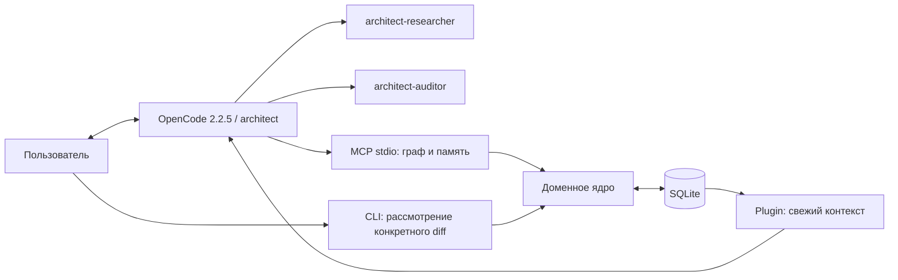

# Работа в OpenCode 2.2.5

Руководство для пакета **0.3.0**, MCP SDK **2.3.0**. Схема графа и методология —
**0.1**; ревизия конкретного графа меняется независимо. Начальная установка из Git
описана в [README](../README.md#установка-из-исходников).

## Что реализовано

`architect_harness.opencode` устанавливает адаптер в выбранный репозиторий.
Версионирование графа, происхождение свидетельств, ревизии, рассмотрение diff
и MCP-инструменты остаются в существующем ядре. Нет второго хранилища решений.
В 0.3.0 добавлены отмена и замещение предложений с сохранением истории (ADR-009).
Ядро не зависит от MCP, LLM-провайдера или UI.



## Роли и полномочия

Установщик создаёт ровно три роли ниже. `worker`, `orchestrator`, дополнительные
MCP-серверы и Code Mode не устанавливаются и не разрешаются автоматически.
Их подключение и полномочия определяет пользователь своего хоста отдельно.
Plugin умеет добавлять память и архивирование также существующим профилям
`worker` и `orchestrator`; это не добавляет им разрешений.

| Роль | Возможности |
|---|---|
| `architect` | Читать код и источники; изменять граф через MCP; сохранять checkpoint; читать архивы; задавать вопросы; вызывать только двух своих помощников |
| `architect-researcher` | Читать код, граф и источники; запрашивать разрешение на shell для конкретного исследования; не изменять граф через MCP |
| `architect-auditor` | Читать код, граф и источники; проверять конкретный diff; без shell и записи |

Каждая роль начинает список `permissions` с `deny` для всех действий, затем
разрешает перечисленные действия. Shell и редактирование у архитектора запрещены;
самосогласование через CLI не является его инструментом. Имена V2: `shell`,
`subagent`, `edit`. Исследователь возвращает факты и пределы проверки родителю,
а архитектор сохраняет наблюдение с происхождением `reported`.

Разрешения относятся к этим профилям и инструментам OpenCode. Если пользователь
разрешит исследователю произвольный shell, тот получит права процесса ОС.
Другой профиль, session overrides, сторонний plugin или прямой доступ к БД
не контролируются этой интеграцией. Это локальная граница работы, не изоляция ОС.

## Автоматическая память

Plugin `architect-harness` использует V2 hooks `context`, `compaction`, `generate`,
`experimental.idle` и `tool.execute.before`.
Память и архивирование также применяются к подключённому `orchestrator`;
его периодическое сжатие использует тот же интервал 8 безопасных завершений,
что и `architect`. После завершённой compaction orchestrator обязан заново получить
полный действующий архитектурный контракт до зависимой работы; plugin напоминает
об этом с ID compaction, но напоминание не доказывает фактическое чтение.
Перед соответствующим запросом plugin получает реальную location сессии, проверяет,
что она принадлежит установленному проекту, и запускает Python через `execFile`
с массивом аргументов. Shell-подстановок и npm-зависимостей нет.

Команда `opencode-context` открывает граф SQLite в `mode=ro`, собирает контекст тем же
доменным сборщиком, добавляет последний операционный checkpoint и передаёт их в
запрос как явно обозначенные данные. Checkpoint и архивы находятся в соседней
`architecture.context.sqlite`; эта БД не выдаёт согласований и не меняет граф.
Управляемая методология содержится в system prompt агента; текст узлов и
свидетельств не превращается в управляющие инструкции. XML-разделители в JSON
экранируются. Это разметка доверия, не доказанная защита от всех prompt injections.

Память читается заново перед каждым шагом, без кэша ревизии между сессиями.
Сжатие истории получает актуальные ограничения; следующая генерация снова
восстанавливает их из БД. Для углубления по узлу агент использует MCP `get_context`
с `focus`. `/arch-focus` не задаёт постоянный глобальный фокус: он относится
к текущему запросу агента.

Сборщик начинает с мягкого лимита 30 структурных узлов. Для автоматической
вставки действует отдельный предел 16 000 байт UTF-8, а при известном размере
окна — меньшее из него и 12% окна, выраженных в байтах. Это консервативный
ориентир, не точный токенизатор провайдера. Если полный контекст велик, остаются
обязательные ограничения, checkpoint и индекс объектов со ссылками для догрузки.
При переполнении самой обязательной части запрос прекращается с ошибкой.
Лимит вывода subprocess — 1 MiB, таймаут — 10 секунд.

OpenCode получает `compaction.auto=true`, `buffer="30%"`, `keep.tokens=6000`.
Plugin дополнительно запрашивает сжатие после 8 разных завершённых ходов primary
при отсутствии фоновой работы. Повтор idle с тем же ID ответа не увеличивает
счётчик. Завершённая compaction сбрасывает отсчёт. По процедуре каждое задание
помощнику начинается в свежей сессии. Технически hook удаляет `sessionID` и
отклоняет brief больше 8000 байт только у вызовов `subagent` от `architect`.
Для других ролей этот enforcement не заявляется.

Перед compaction архивируется доступный transcript; длинные MCP-результаты
также сохраняются целиком. Подробности читаются через `list_details`,
`search_detail`, `read_detail`. Полная политика, пределы гарантий и восстановление
описаны в [CONTEXT_POLICY.md](CONTEXT_POLICY.md).

## Команды пользователя

| Команда | Действие |
|---|---|
| `/arch-start <задача>` | Начать с существующего окружения, границы системы и реального сценария |
| `/arch-focus <ID или вопрос>` | Углубить важный участок и получить основания для решения |
| `/arch-review <change_ID>` | Проверить неизменяемый diff с независимым аудитором |
| `/arch-resume` | Продолжить по принятому графу и открытым вопросам |

Это prompt-команды, выбирающие `architect`, а не shell-макросы. Их аргументы
не исполняются. Модель выбирает инструменты в пределах полномочий.

Для пакетного запуска используется настоящий CLI V2:

```bash
opencode run --agent architect --format json "Прочитай архитектурный контекст и перечисли ближайшие неизвестности"
```

Команда требует модели, настроенной в OpenCode. Поставляемые автоматические
проверки не отправляют запросы провайдеру и не оценивают качество этой модели.

## Рассмотрение существенного изменения

1. Агент получает текущую ревизию, готовит `propose_change`, показывает diff,
   `change_id`, `base_revision` и причины рассмотрения.
2. Пользователь изучает предложение. При необходимости `/arch-review change_ID`
   помогает проверить его, но не выдаёт согласование.
3. Оператор выполняет CLI в отдельном терминале. Ниже `HARNESS` — абсолютный путь
   к исходникам с установленным `.venv`; команды выполняются из целевого проекта:

```bash
"$HARNESS/.venv/bin/python" -m architect_harness --db .architecture/architecture.sqlite show-change CHANGE_ID
"$HARNESS/.venv/bin/python" -m architect_harness --db .architecture/architecture.sqlite approve CHANGE_ID --revision N --reviewer "Владелец проекта"
```

Подставьте реальный ID и базовую ревизию `N` из рассмотренного неизменного diff.
Она должна совпадать с текущей ревизией; при расхождении подготовьте новый diff.
Если харнесс установлен в другом репозитории, используйте Python окружения
харнесса и абсолютный путь к БД того репозитория. Оба пути доступны агенту
в `architecture_context.operator`.

4. Вернитесь к агенту: «Предложение согласовано через CLI, примени его».
   Агент вызывает `apply_change`; ядро само проверяет сохранённое согласование
   и ревизию. При конфликте агент получает новый контекст и пересматривает пакет.

Локальные изменения без `review_required` применяются сразу. `approve` отсутствует
в MCP. Идентификатор reviewer — запись об авторстве, не аутентификация.

### Отмена и замещение (0.3.0)

Из целевого проекта оператор может прочитать lifecycle и отменить неприменённое
предложение. `N` для cancel — текущая ревизия из заголовка списка:

```bash
"$HARNESS/.venv/bin/python" -m architect_harness --db .architecture/architecture.sqlite list-changes
"$HARNESS/.venv/bin/python" -m architect_harness --db .architecture/architecture.sqlite cancel CHANGE_ID --revision N --reviewer "Владелец проекта"
```

Список показывает payload- и эффективный статусы, base/applied revision, время и автора.
`cancel` не доступен через MCP. Отмена добавляет событие `cancel`, не переписывая
payload предложения, его рассмотрение и граф.

Для перевыпуска агент готовит новый diff через MCP `propose_change` на актуальной
ревизии с optional `supersedes=CHANGE_ID` (CLI `propose` этот параметр не передаёт).
Цель остаётся активной до успешного apply замены после отдельного операторского
approve. Только тогда атомарно добавляется событие `supersede`. Approval старого
предложения не переносится; CAS не обходится. Терминальные предложения отклоняются
при approve/apply с `proposal_cancelled` или `proposal_superseded`.
Отмена/замещение не делают устаревшее предложение применимым. Подробнее —
[ADR-009](DECISIONS.md#adr-009-терминальный-lifecycle-предложений-без-переписывания-истории).

## Установка и перенос

Установщик сохраняет сторонние поля `.opencode/opencode.json`, модели, MCP-серверы
и plugins. Перед первым изменением существующего JSON он сохраняет
`opencode.json.before-architect`. Повтор той же установки не сбрасывает БД.
Другой project-id в существующей БД отклоняется. Содержимое bootstrap-примера
автоматически не применяется: новый граф пустой.

При конфликте одноимённых ролей, изменённого plugin или JSONC установщик останавливается
с конкретной ошибкой. Автоматической принудительной перезаписи нет. Сначала
сохраните свои файлы, объедините необходимые настройки, затем повторите установку.
После обновления версии сравните поставленный `assets/opencode-plugin.js`
со своей копией: автоматический updater пользовательских правок не реализован.

Абсолютные пути привязывают установку к выбранному Python и проекту. Переносимым
дистрибутивом служит Python wheel и исходники, а конфигурация генерируется на месте.
Саму `.architecture/architecture.sqlite` переносите отдельно как состояние проекта;
при запущенном процессе используйте SQLite backup, а не копирование одного файла
без WAL. При установке в существующий граф укажите его project-id.

`opencode-doctor` проверяет локальную конфигурацию, файл plugin, память и версии.
Если модель не подключена, выберите её через интерфейс OpenCode. При ошибке MCP
проверьте Python в `mcp.servers.architect.command`, пакет `[mcp]`, абсолютный путь
БД и `protocol: "2026-07-28"`. Plugin и MCP должны читать одну БД.

## Необязательный внешний worker

Этот раздел применим только если профиль `worker` уже определён пользователем.
Он не входит в штатную поставку; приведённая настройка не даёт архитектору права
вызывать его автоматически.

Проверяйте каталог именно заблокированной сессии: настройки установки харнесса
не распространяются автоматически на другие проекты. Верхнеуровневый legacy
`permission.bash: "deny"` преобразуется OpenCode 2.2.5 в запрет `shell` и может
скрыть инструмент у worker. Для разрешения команд с подтверждением добавьте
в `agents` файла `.opencode/opencode.json` целевого проекта частичный профиль:

```json
"worker": {
  "mode": "subagent",
  "permissions": [{"action": "shell", "resource": "*", "effect": "ask"}]
}
```

Модель и инструкции наследуются из существующего профиля. Проверьте результат
из каталога целевого проекта командой `opencode --standalone debug agents`:
последнее подходящее правило worker должно быть `shell / * / ask`.
Обычный `opencode debug agents` может обращаться к фоновому серверу со старым
кешем; в этом случае перезапустите сервер или запустите OpenCode с `--standalone`.
Создание новой сессии на старом сервере само по себе не доказывает перезагрузку.
Отдельно учитывайте permissions самой сессии: они применяются после правил агента.

Встроенный `shell` не обязан присутствовать в MCP-каталоге `tool-discovery`.
Пустой результат поиска там не доказывает отсутствия встроенного инструмента.
Файлы результатов OpenCode читаются встроенным `read`; отсутствие попытки чтения
не является свидетельством отказа в доступе.

## Проверки и первичные контракты

Unit-проверки покрывают целостность графа, безопасную установку, конфликтующие
файлы, сохранение памяти и чтение без изменения БД. Node-тест запускает настоящий
Python и проверяет обработчики plugin на границе hook API. MCP roundtrip использует
официальный SDK и реальный stdio-процесс, включая отказ без согласования.
`scripts/opencode_smoke.py` запускает отдельный OpenCode 2.2.5 и проверяет загрузку
конфигурации, агентов, plugin и MCP. Точный объём проверки записан в его JSON-отчёте.

Контракты сверены с [конфигурацией V2](https://opencode.ai/v2/docs/config/),
[разрешениями](https://opencode.ai/v2/docs/permissions/),
[MCP](https://opencode.ai/v2/docs/mcp-servers/),
[server plugin API](https://opencode.ai/v2/docs/build/plugins/server), а также
исходниками тега [v2.2.5](https://github.com/anomalyco/opencode/tree/v2.2.5).
Адаптер не использует legacy hooks `experimental.chat.system.transform`, поля
V1 `agent`, `permission` или старый формат `mcp.<name>`.
