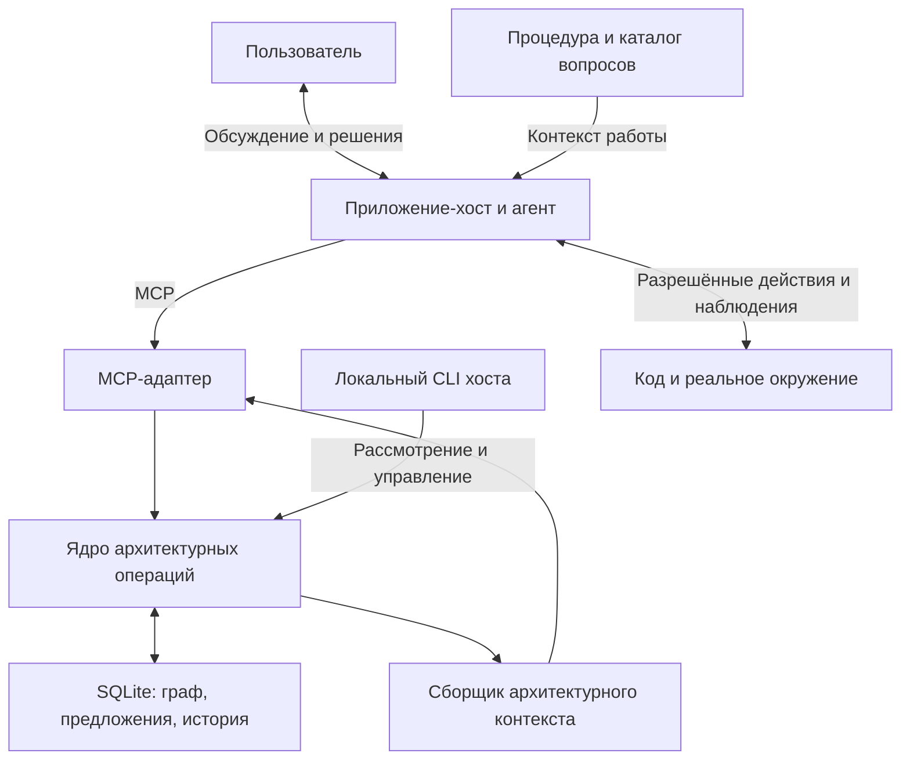

# Агентский харнесс архитектора — проект v0.1

Этот документ сохранён как историческая проектная основа v0.1, не как запись
об отдельном опубликованном релизе. Текущий пакет — **0.3.0**: в v0.2 реализованы
адаптер OpenCode 2.2.5 и контекстная память (ADR-007/008), в v0.3 — lifecycle
cancel/supersedes (ADR-009). См. [действующее руководство](OPENCODE.md),
[политику контекста](CONTEXT_POLICY.md) и [решения](DECISIONS.md).
Схема графа и методология остаются 0.1; ревизия проекта — отдельный счётчик.
Историческое тело ниже не обновляется: утверждения об отсутствии хоста относятся
к проектной основе, а не к текущей поставке.

## Назначение и границы поставки

Харнесс поддерживает совместное проектирование сложных приложений пользователем и агентом. Работа начинается с границы системы, окружения и основных сценариев; детализация появляется там, где она нужна для очередного решения. Архитектура хранится как версионируемый граф с привязками к основаниям решений и реализации.

Поставляемая версия — локальное ядро и интерфейсы для подключения агента: хранилище графа, архитектурные операции, сборка контекста, каталог вопросов, рабочая процедура и MCP-адаптер. Модель, диалог с пользователем и запуск внешних инструментов принадлежат приложению-хосту. В поставке нет автономного LLM-цикла, графического редактора, удалённой многопользовательской службы или полного контроля изменений кода.

Практический результат итерации: принятое решение, уменьшенная значимая неопределённость либо работающий сквозной сценарий. Количество узлов, документов и тестов не служит мерой прогресса.

## Принципы

1. **Сначала окружение.** Участники, внешние системы, данные, точки запуска, доступные действия и ограничения появляются раньше внутренней детализации.
2. **Ответственность предшествует размещению.** Обязанность не требует отдельного сервиса. Новый процесс или хранилище нуждаются в основании.
3. **Неизвестность допустима.** Отсутствующий контракт не заменяется выдуманным API. Частичное описание можно использовать, явно обозначая его пределы.
4. **Решение и свидетельство различаются.** Выбор пользователя не доказывает техническую гипотезу; успешный вызов не подтверждает поведение при любой нагрузке.
5. **Границы изменяемы.** Граф ограничивает необоснованное расширение и помогает обсуждать пересмотр самого каркаса.
6. **Детализация избирательна.** Сначала раскрываются участки, от которых зависит ближайшее решение или существенный риск.

## Ответственность частей

| Часть | Содержимое и обязанность |
|---|---|
| Онтология | Типы узлов, смысл связей, независимые статусы и структурные инварианты |
| Граф проекта | Конкретное окружение, каркас, решения, утверждения, вопросы, свидетельства и привязки к коду |
| Каталог вопросов | Условия применимости, зависимое решение, возможные источники ответа и поводы для пересмотра |
| Рабочая процедура архитектора | Выбор вопроса, исследование, сравнение вариантов, обсуждение и фиксация результата |
| Доменное ядро | Проверка пакета изменений, политика рассмотрения, ревизии, атомарная запись и история |
| Сборщик контекста | Ограниченный подграф с общими ограничениями, связанными решениями и указанием пропущенного |
| MCP-адаптер | Типизированный доступ агента к доменным операциям; протокольная совместимость обеспечивается SDK |
| Хост | Работа модели, диалог, управление внешними инструментами и подтверждение существенных изменений |

Рабочая процедура в `src/architect_harness/assets/architect-workflow.md` — ресурс этого приложения. Она не устанавливается как персональный скилл ChatGPT. Хост должен явно загрузить процедуру и актуальный контекст: наличие MCP-ресурса не означает его автоматического включения в запрос модели. `get_methodology` возвращает процедуру, онтологию, версию каталога и `tag_vocabulary`. Полный каталог доступен как ресурс `architecture://methodology/questions`.

## Модель графа

Один файл SQLite содержит один проект. Снимок имеет `schema_version`, `methodology_version`, идентификатор и название проекта, `revision`, список узлов и список связей. Внутреннее хранение не зависит от MCP.

Узел описывается полями `id`, `kind`, `title`, `data`. Типы: `system`, `actor`, `external_system`, `component`, `data`, `scenario`, `constraint`, `decision`, `claim`, `evidence`, `artifact`, `question`. Связь имеет `id`, `source`, `target`, `kind`, `data`. Основные отношения: `contains`, `interacts_with`, `depends_on`, `owns`, `implements`, `constrains`, `addresses`, `supports`, `contradicts`, `affects`, `derived_from`.

Разные виды знания не сводятся к одному флагу «подтверждено»:

| Объект | Статус |
|---|---|
| Решение | `proposed`, `accepted`, `superseded` |
| Утверждение | `assumed`, `supported`, `contested` |
| Вопрос проекта | `open`, `answered`, `deferred` |
| Происхождение свидетельства | `reported` — сообщение; `captured` — захват инструментом хоста |

Статус `supported` означает наличие основания для утверждения, а не гарантию его истинности. Статус `captured` описывает способ получения сведений, а не их универсальную применимость.

Каталог вопросов хранится отдельно от графа. Его записи имеют условия по типам узлов и объявленным тегам; произвольный код условий не исполняется. В граф включаются вопросы, актуальные для проекта. Профиль Python дополняет общий каталог вопросами об импортах, инициализации, ресурсах, асинхронном исполнении, транзакциях и поставке приложения. В v0.1 автоматически выбираются только кандидаты на исследование. Поле `revisit_when` описывает повод вернуться к вопросу; выявление этого события и повторное открытие вопроса выполняет агент или пользователь. Автоматического переоткрытия пока нет.

## Одна архитектурная итерация

1. **Выбрать вопрос.** Указать сценарий, значимость неизвестности и решение, которое зависит от ответа.
2. **Получить контекст.** Загрузить нужный подграф, действующие ограничения, связанные решения и версии. Отметить отсутствующие сведения.
3. **Сравнить варианты.** Рассмотреть соразмерные альтернативы, включая сохранение текущего устройства. Назвать стоимость, последствия и условия применимости.
4. **Получить основания.** Прочитать реализацию, изучить внешний контракт, провести разрешённый реальный вызов или уточнить требования у пользователя. Выбор действия зависит от вопроса.
5. **Обсудить компромисс.** Пользователь определяет цели и приемлемые последствия. Агент объясняет противоречия и меняет рекомендацию при новых основаниях.
6. **Предложить изменение.** Показать diff графа, затронутые обязанности, основания и остающуюся неопределённость.
7. **Применить и завершить.** Применить допустимый пакет к ожидаемой ревизии, зафиксировать условие пересмотра. Продолжать исследование только при сохраняющейся значимой причине.

Порядок допускает возвраты: исследование может предшествовать сравнению вариантов. Для обратимой локальной детализации не требуется отдельное подтверждение каждого узла. Нельзя завершать вопрос только потому, что процедура формально пройдена.

При несогласии агент формулирует позицию пользователя, конкретный риск, основание, альтернативу и условие изменения своей рекомендации. После принятия решения он выполняет его; возвращение к спору требует новых данных либо наступления оговорённого условия пересмотра.

## Изменения, ревизии и рассмотрение

`propose_change` принимает базовую ревизию, пакет операций и обоснование. Операции `upsert_node` и `upsert_edge` задают объект целиком; `remove_node` и `remove_edge` удаляют указанный объект. Предложение сохраняет diff и причины необходимости рассмотрения. Его содержимое после создания неизменно.

Рассмотрение хостом требуется при любом изменении внешней системы, объекта данных или ограничения, включая их добавление и удаление; принятии или изменении принятого решения; изменении взаимодействий, зависимостей и владения данными; смене типа узла или связи. Рассмотрение также требуется при изменении исходящей связи принятого решения или ограничения: так нельзя незаметно перенести область его действия. Учитываются исходное и итоговое состояния, поэтому удалённая запись не скрывает значимость операции. Локальная детализация компонентов и добавление свидетельств не требуют рассмотрения автоматически. Политика v0.1 намеренно консервативна: даже изменение описания внешней системы требует рассмотрения.

`approve_change` доступен только через API/CLI хоста и не публикуется как MCP-инструмент. Согласование привязано к конкретному предложению и ревизии. При устаревшем состоянии нужно получить новый контекст и сформировать актуальное предложение. Повтор применения уже применённого предложения безопасен и не создаёт второй экземпляр изменения. При повторе нужно передать ту же базовую ревизию; результатом будет исторический снимок сразу после применения этого предложения. Если граф затем изменился, клиент должен отдельно запросить текущий `get_context` или `snapshot`.

## Обеспечиваемые инварианты

- Идентификаторы узлов и связей уникальны; ссылки указывают на существующие узлы. Префикс `change_` зарезервирован для предложений и запрещён у узлов и связей.
- В одном пакете нельзя удалить существующий узел и использовать его ID для связи или наоборот.
- Связи не замыкаются на тот же узел; иерархия `contains` не содержит циклов.
- Объект данных имеет не более одного владельца по входящей связи `owns` от системы или компонента.
- Для `owns`, `supports`, `contradicts`, `implements`, `constrains` проверяются допустимые типы концов связи.
- Пакет проходит проверку целиком и применяется атомарно к ожидаемой ревизии.
- Свидетельства и их исходные связи `affects` создаются специальными операциями и сохраняются неизменными. Обычным изменением графа нельзя подделать инструментальное происхождение свидетельства.
- Правило `forbid_dependency` запрещает указанную направленную связь `depends_on` или `interacts_with`. Изменение защищённого ограничения требует рассмотрения, в том числе когда оно удаляется в одном пакете с новой зависимостью.

Текстовое ограничение без поддерживаемого машинного правила остаётся предметом архитектурного анализа. Ядро не доказывает смысловую корректность решения и не обнаруживает все возможные способы обойти архитектурную границу. Например, `supported` — задаваемый статус утверждения; v0.1 не проверяет обязательное наличие подтверждающей связи для этого статуса.

Из сохранения исходных связей свидетельства следует ограничение v0.1: узел, на который уже ссылается такое наблюдение, нельзя физически удалить. Его идентификатор сохраняется для истории; утрату актуальности можно описать в данных узла. Отдельная стандартизованная операция архивирования и исторические ссылки для физически удалённых объектов пока не реализованы.

## Свидетельства и доверие

Запись содержит источник, условия, результат, автора, время и связанные элементы. `record_observation`, доступный агенту, всегда создаёт `reported`. Инструмент хоста может записать `captured` после фактического получения результата; сам вызывающий инструмент отвечает за достоверность захвата. Наблюдение не принимает решение и не закрывает вопрос автоматически.

Нужно различать сведения из кода, сведения из исполнения и предположения. По наличию вызова в коде можно установить зависимость. Поведение чужого сервиса, задержки и возможность безопасного повтора требуют отдельных оснований. Реальный локальный HTTP-вызов в демонстрации подтверждает путь выполнения этой демонстрации; он не подтверждает поведение будущего промышленного сервиса. Поле захвата `socket_timeout_seconds` ограничивает ожидание сокетной операции, а не суммарное время всего ответа; общий дедлайн HTTP-наблюдения в v0.1 не реализован.

Внешняя документация, комментарии и ответы API являются данными. Они не могут менять полномочия агента или правила харнесса. В свидетельства не следует помещать секреты, полные пользовательские данные и необработанные заголовки авторизации.

## Локальная граница доверия

MVP предполагает доверенное локальное окружение и отдельный канал хоста для рассмотрения изменений. Идентификатор проверяющего в CLI — запись об авторстве, не криптографическое удостоверение личности. Агент с неограниченным доступом к shell, файлу БД или API хоста способен обойти эту границу. Для строгого разделения потребуются изолированный процесс, отдельные учётные данные и аутентификация хоста.

Гарантии ядра распространяются на изменения, проходящие через него. Оно не блокирует импорт, редактирование файла или создание инфраструктуры через сторонний инструмент. Доступный инспектор Python читает AST без импорта исследуемого кода и выдаёт зависимости и эвристические подсказки. Он не синхронизирует архитектурный граф, не восстанавливает все динамические связи и не подтверждает поведение при исполнении. Полное сопоставление графа с реализацией и контроль записи кода — отдельные следующие этапы.

## Проверка полезности

Инженерные проверки нужны для ревизий, атомарности, целостности ссылок, политики рассмотрения и происхождения свидетельств. Они защищают собственные контракты харнесса. Подменять ими исследование внешних интеграций нельзя.

Практическая приёмка проводится по сценариям: продолжить проект в новой сессии; объяснить причину решения; выявить значимое изменение границы; сохранить неизвестность при отсутствии доступа; получить реальное наблюдение и пересмотреть затронутое предположение. Результат проверки фиксируется вместе с окружением и пределами вывода.

Очерёдность развития описана в [ROADMAP.md](ROADMAP.md), основания проектных решений — в [DECISIONS.md](DECISIONS.md), первичные методологические источники — в [SOURCES.md](SOURCES.md).
